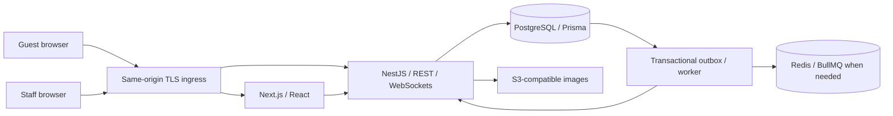

# MenuFlow

**QR-based restaurant ordering and management for cafés and restaurants.**

MenuFlow is a planned multi-tenant SaaS platform that connects a restaurant's digital menu, table service, kitchen, and cashier. Guests scan a table QR code, browse the menu, place orders, follow preparation, request assistance, and review an itemized bill without creating an account or installing an app.

The initial market is Ethiopia, with ETB pricing and English/Amharic support. The architecture is designed to support additional languages, currencies, and branches as the product grows.

> **Project status — Phase 0: planning and architecture.** This repository currently contains the product and engineering design. There is no runnable application, implemented API, database schema, migration, or deployed service yet. Phase 1 begins only after the repository owner's approval.

## Product scope

| Audience | Planned experience |
|---|---|
| Guests | Mobile menu, categories/search, variants and modifiers, cart, order tracking, service requests, running bill, optional tip, checkout and receipt |
| Waiters | Assigned tables, guest admission, service requests, ready orders and serving confirmation |
| Kitchen staff | Live preparation queue, item instructions, acceptance and preparation status |
| Cashiers | Itemized bills, authorized adjustments, cash recording, receipts and transaction history |
| Restaurant owners/managers | Restaurant/branch settings, menus, availability, specials, tables, QR codes, staff and sales reports |
| Platform administrators | Tenant lifecycle, platform operations and subscription metadata |

These are planned capabilities, not a list of completed features. Initial payment scope is recorded cash; digital providers and live subscription charging require separate implementation and explicit approval.

## Architecture

MenuFlow uses a modular monolith: one NestJS backend owns business rules and data, while Next.js serves the customer and staff interfaces. REST APIs perform commands and authoritative reads; WebSockets deliver recoverable updates after database commits.



| Layer | Planned technologies |
|---|---|
| Web | Next.js App Router, React, strict TypeScript, Tailwind CSS, shadcn/ui, Lucide |
| Client state and forms | TanStack Query, React Hook Form, Zod |
| API | Node.js, NestJS, REST, WebSockets, request validation, Swagger/OpenAPI |
| Data | PostgreSQL, Prisma, one canonical schema, version-controlled migrations |
| Jobs and assets | Redis/BullMQ when required; S3-compatible image storage |
| Development and delivery | pnpm workspaces, Docker Compose, GitHub Actions; Turborepo only if justified |
| Verification | Unit, real-database integration, API, authorization/isolation, financial/concurrency and Playwright E2E tests |

Exact versions will be selected, compatibility-tested and pinned in Phase 1. No dependency manifest or lockfile exists yet.

## Design commitments

- **Tenant isolation:** backend permissions and branch scope, composite database relationships, and proposed PostgreSQL row-level security.
- **Safe table access:** a QR identifies a table; it does not authorize access to a live bill. Proposed staff-approved device admission and a separate bill-host capability protect diners' information.
- **Authoritative prices:** the server validates availability, modifiers and prices. Orders preserve snapshots so menu edits cannot rewrite purchases.
- **Exact money:** integer minor units, explicit rounding, versioned invoices and separate tip records. Client-calculated totals are never authoritative.
- **Reliable commands:** idempotent orders and settlements, transactional state changes and durable events protect against retries and concurrent requests.
- **Voluntary tips:** no preselected tip; no tip, 5%, 10%, 15% and custom choices, separate from mandatory charges.
- **Honest payment state:** cash is recorded only by an authorized cashier. Future digital payments require trusted server verification.
- **Accessible interfaces:** mobile-first guest screens, responsive staff tools, English/Amharic localization, and explicit loading/empty/error/success states.

These commitments must be implemented and tested in the phases below. They are not security or production-readiness certifications.

## Documentation

| Document | What it covers |
|---|---|
| [Product requirements](docs/PRD.md) | Scope, roles, measurable requirements, workflows, UX and proposed service targets |
| [System architecture](docs/ARCHITECTURE.md) | Module boundaries, API contracts, authorization, QR sessions, realtime, transactions and operations |
| [Database design](docs/DATABASE_DESIGN.md) | Entity relationships, monetary model, constraints, indexes, concurrency and migration strategy |
| [Implementation plan](docs/IMPLEMENTATION_PLAN.md) | Phase milestones, acceptance criteria, tests, dependencies, risks and approval gates |
| [Decisions and open questions](docs/DECISIONS.md) | Confirmed requirements, proposed defaults, business decisions and deadlines |
| [Repository gap analysis](docs/GAP_ANALYSIS.md) | Inspection evidence, available tools, missing implementation and verification limits |

Start with the product requirements and decisions. The guest admission policy, group-bill visibility, payment scope, tax/receipt rules and tip allocation should be resolved before their dependent implementation.

## Roadmap and delivery gates

| Phase | Outcome | Status |
|---|---|---|
| 0 | Repository inspection, product/architecture/database planning and README | Documentation prepared; approval pending |
| 1 | Monorepo, web/API foundation, database connectivity, local infrastructure, CI and health | Not started |
| 2 | Schema/migrations, authentication, tenant isolation, roles and onboarding | Not started |
| 3 | Restaurant, branch, staff, table and menu management | Not started |
| 4 | QR lifecycle, safe guest sessions, customer menu and cart | Not started |
| 5 | Ordering, kitchen, waiter service and realtime | Not started |
| 6 | Billing, voluntary tipping, cash settlement and receipts | Not started |
| 7 | Analytics and platform administration | Not started |
| 8 | Security/operational hardening and release-readiness evidence | Not started |

Every phase requires a report and owner approval before the next phase. Production deployment, changes to live infrastructure and live subscription integrations require explicit approval. See the implementation plan for testable exit criteria.

## Repository layout

Current contents:

```text
MenuFlow/
├── README.md
└── docs/
    ├── PRD.md
    ├── ARCHITECTURE.md
    ├── DATABASE_DESIGN.md
    ├── IMPLEMENTATION_PLAN.md
    ├── DECISIONS.md
    └── GAP_ANALYSIS.md
```

The planned monorepo adds `apps/web`, `apps/api`, `packages/shared`, `packages/ui`, `packages/config`, a single root `prisma` directory, infrastructure definitions and CI workflows. Those directories will be created in their approved phases.

## Getting started today

Clone the repository and read the planning documents:

```sh
git clone https://github.com/Gech-E/MenuFlow.git
cd MenuFlow
```

There is no install/build/dev/test command for an application yet. Do not expect `pnpm install`, `pnpm dev`, migrations or Docker Compose to start services from this Phase 0 repository. Verified setup commands, environment-variable documentation and troubleshooting will be added with the working Phase 1 foundation.

The initial workstation inspection found Node.js `24.22.2`, pnpm `11.25.0` and Git `2.56.0.windows.2`; Docker was not available on PATH. These are observations, not supported-version guarantees. Local infrastructure availability and framework compatibility must be verified in Phase 1.

To inspect your local tooling without installing dependencies:

```sh
node --version
pnpm --version
git --version
```

## Development and verification policy

Work in small, complete increments within the approved phase. Keep documentation, API contracts and migrations synchronized with behavior. Each successful feature is committed as a coherent unit after its applicable checks pass; commits should describe the behavior and purpose, for example `feat(orders): prevent duplicate table orders`. Preserve remote history and use normal fast-forward pushes or the repository's required review flow.

A completed feature needs working backend and integrated frontend, validation and authorization, appropriate persisted state, error handling, relevant passing tests, responsive verification and updated documentation. A planning document is a documentation deliverable, not an implemented feature.

Important verification includes cross-tenant/cross-branch access denial, QR/session isolation, legal state transitions, order and checkout races, duplicate-payment prevention, exact financial arithmetic, receipt reconciliation, and complete guest-to-cashier journeys. No application test suite exists or has run in Phase 0.

## Security and operations

Never commit credentials, real environment files, customer information or raw card details. Development seed data must remain clearly local/test-only. Future environment examples will contain safe samples and document required configuration.

Production readiness requires tested authorization, dependency review, verified migrations, structured monitoring, encrypted backups and a successful restoration drill. Tax policies, fiscal receipt requirements, data retention and tip attribution need business validation; this repository does not claim legal compliance.

For a suspected vulnerability, contact the repository owner privately through an available private channel; do not publish secrets or exploit details in a public issue. A dedicated reporting channel and formal license have not yet been selected.

## Ownership and license

Repository: [Gech-E/MenuFlow](https://github.com/Gech-E/MenuFlow). No license has been selected or granted in this planning phase. The owner should choose licensing terms before external reuse or contributions are invited.
