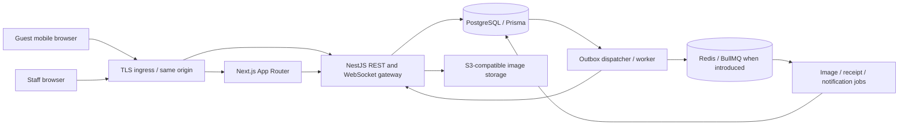
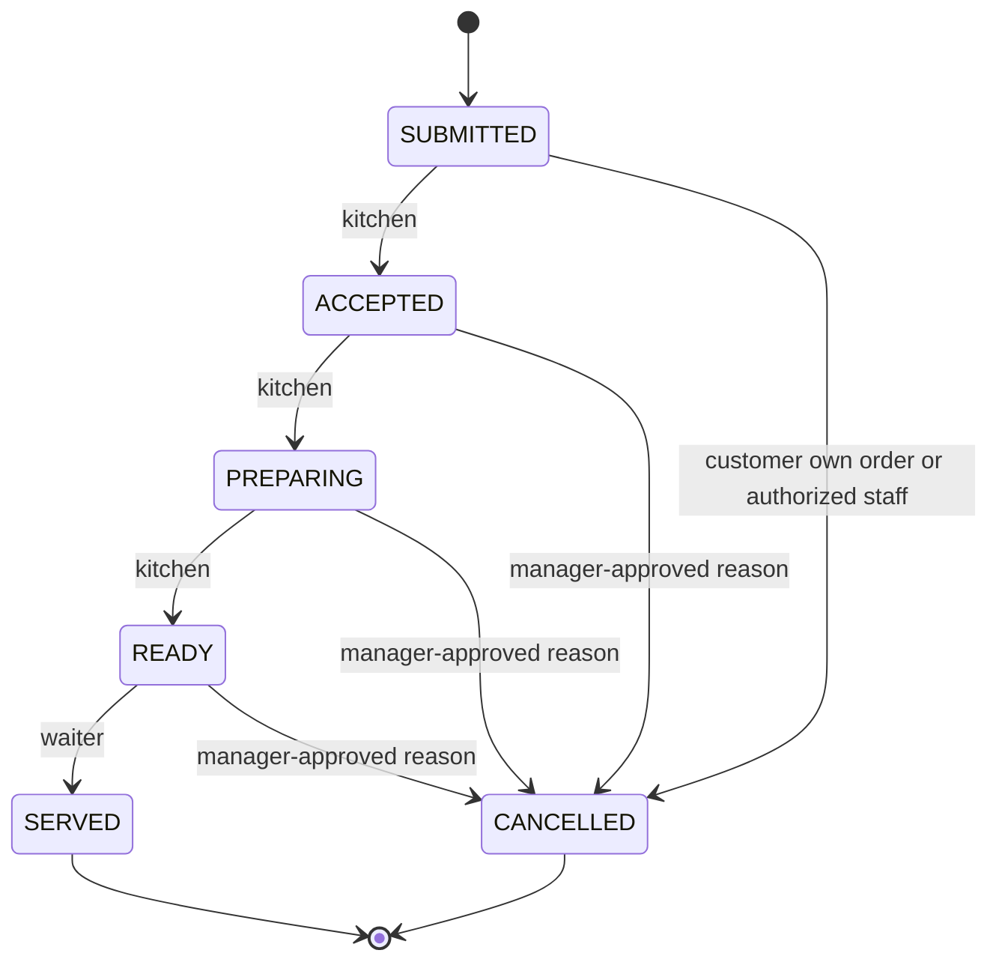

# MenuFlow — System architecture and API design

Phase 0 proposal • 2026-11-06 • Not implemented. Product policy is in [PRD](PRD.md); schema invariants are in [DATABASE_DESIGN](DATABASE_DESIGN.md).

## 1. Architecture

Use a modular NestJS monolith and a Next.js App Router frontend in a pnpm workspace. PostgreSQL is the source of truth. One backend owns authentication, authorization, orders and money; the frontend never directly accesses the database. REST owns commands and reads; WebSockets announce committed changes. Durable events use a database outbox. Redis/BullMQ are introduced for actual asynchronous needs, not as a second source of order or payment state.



Deploy web and API as separate processes from one repository. A worker is another process from the same backend codebase, not an independently owned microservice. Same-origin routing sends `/api/v1/*` and `/socket.io/*` to Nest and page routes to Next. API calls from server rendering forward only explicitly allowed credentials and use no shared caching for private data. Public menu caching includes tenant, branch, locale and publication version; order availability is always rechecked.

## 2. Proposed repository and dependencies

```text
apps/
  web/{app,components,features,hooks,lib,public}
  api/src/{modules,common,config,main.ts}
  api/test/
packages/
  shared/              # pure domain types, money and validation helpers
  ui/                  # shared accessible shadcn-based components/tokens
  config/              # strict TypeScript, lint and formatting configurations
prisma/
  schema.prisma        # the only Prisma schema
  migrations/          # Prisma and reviewed SQL constraints/RLS/indexes
  seed.ts              # development/test only, added in Phase 2
docs/
infrastructure/
.github/workflows/
docker-compose.yml
.env.example
pnpm-workspace.yaml
package.json
README.md
```

This tree is planned; only documentation exists in Phase 0. Use Next.js/React/TypeScript strict/Tailwind/shadcn/Lucide, TanStack Query for remote browser state, React Hook Form and Zod for forms. Nest uses boundary DTO validation (class-validator or a consistent Zod integration), Swagger/OpenAPI, structured errors and guards. Backend schemas are authoritative; generated API types must be checked for drift. Shared code must not export database clients or secrets into web bundles.

Pin supported, compatible framework/runtime/package-manager versions and lock dependencies in Phase 1. Do not choose incompatible versions by mixing current and older tutorials. pnpm workspace scripts are sufficient initially; add Turborepo only if measured build orchestration benefits justify it. Compose will provide PostgreSQL and, when needed, Redis and S3-compatible local storage. Tests use real isolated PostgreSQL for constraints and transactions.

## 3. Module boundaries

| Module | Owns | Collaboration |
|---|---|---|
| Identity/access | Users, password credentials, staff sessions, invitations, memberships, branch scope | Supplies verified actor context to all services |
| Tenancy/platform | Restaurants, lifecycle, branding, subscription metadata | Tenant policy checks; no automatic restaurant-data access for admins |
| Branches/tables | Hours, table definitions, QR lifecycle, assignments | Public locator resolution and scoped staff management |
| Menu/catalog | Categories, variants, modifiers, translations, schedules, publication, images | Authoritative quote inputs; immutable snapshots handed to ordering |
| Dining | Sessions, guest admissions, host capabilities, session locks | Shared transactional boundary for ordering and billing |
| Ordering | Orders/items, transitions, cancellations, idempotency | Calls pricing; emits outbox events after durable state changes |
| Service | Assistance and waiter acknowledgments | Branch/table authorization and deduplication |
| Billing | Discounts, tax/service calculation, invoice revisions, tips | Freezes session; recomputes from immutable line snapshots |
| Payments | Cash ledger, provider interface, receipts, settlement | One transaction with billing/session and audit |
| Analytics | Read models/queries reconciled to settled records | Never modifies source money records |
| Audit/operations | Append-only audit, outbox, health, logging, job controls | Redacted metadata; scoped workers and observability |

Controllers handle transport, services enforce use cases, domain helpers implement pure policies, and repositories encapsulate scoped persistence. A transaction client is passed explicitly across modules participating in a single invariant. Do not nest independent transactions or call external networks while holding financial locks.

## 4. Identity and authorization

Proposed staff authentication uses audited primitives: Argon2id password hashing with parameters benchmarked against current security guidance; random opaque session tokens with only hashes stored server-side. Secure, HttpOnly, SameSite cookies use a host-only scope in production. Staff and guest cookies are separate. No bearer credential in local storage. Rotate sessions on login/privilege elevation, revoke on logout, password reset or membership disable, and apply inactivity/absolute expiry. Proposed staff limits are 30 minutes idle/12 hours absolute; exact values are configurable after operational review.

Bootstrap platform admin through a documented restricted command, never public registration or default credentials. Public owner signup requires verified contact and onboarding abuse controls; invitation-only pilot onboarding is an alternative pending decision. Password reset and invitations are single-use, expiring hash-stored tokens with generic responses. Email transport remains a provider decision; development email capture must never be presented as delivered production mail. Platform administrators require MFA before production, with enrollment/recovery designed in Phase 2 and verified in Phase 8.

Unsafe cookie-authenticated requests require a server-bound CSRF token and exact allowed Origin validation. Validate WebSocket Origin and require a CSRF-protected handshake ticket. SameSite is additional defense. Apply scoped rate limits to login/reset, public lookup/admission, ordering, service requests and uploads; distributed limits are required once API replicas exist. Use explicit allowed development origins and credentials; never wildcard CORS with credentials. GET routes never mutate financial/session state.

Authorization evaluates `(principal, tenant, branch, capability, resource ownership, state)` in Nest services. Guards establish a baseline; service checks cover internal calls and jobs. Permission groups include `tenant.manage`, `staff.invite`, `staff.grant`, `menu.manage`, `availability.set`, `tables.manage`, `sessions.admit`, `orders.prepare`, `orders.serve`, `orders.cancel`, `adjustments.approve`, `payments.record`, `reports.read`, and `platform.tenants.manage`. Guests receive explicit per-session capabilities, not staff roles. The role defaults in [PRD](PRD.md) form the executable permission-matrix test specification.

## 5. Tenant isolation

Every tenant-owned record carries `tenant_id`; branch-owned relationships also enforce branch consistency. Composite foreign keys prevent linking a row to another tenant's object. Repositories require a verified tenant context; query parameters/body fields never establish authority. Missing scope fails closed, including list/search/export and count endpoints.

PostgreSQL RLS is proposed as defense in depth, with `USING` and `WITH CHECK` policies, a nonowner runtime role without `BYPASSRLS`, and separate migration credentials. Set transaction-local tenant context through parameterized SQL on the same connection/transaction used for every scoped query. The context is not proof of identity; the API must authorize it first. Background workers use the same discipline. Test connection pooling and context reset with the exact pinned Prisma/driver versions.

PostgreSQL documents that owners and privileged roles can bypass RLS and that referential integrity checks have special treatment. Therefore RLS does not replace composite constraints, least privilege or service authorization. See [PostgreSQL row-security documentation](https://www.postgresql.org/docs/17/ddl-rowsecurity.html).

Global identity and public tenant/QR resolution use narrow repositories/projections with minimal grants. Do not grant the public API broad bypass access to tenant tables. Resolve a locator to published restaurant/table metadata, then establish only that public read context. Platform reports use explicit platform metadata projections; any exceptional tenant-support access requires a later designed, time-bound audited mechanism.

Storage keys, query cache keys, outbox events, job payloads and socket subscriptions carry validated tenant scope. Private responses are `Cache-Control: private, no-store`; shared CDN caches must never hold session/order/bill content. Mask database uniqueness/FK errors to avoid existence leaks.

## 6. QR and dining-session security

Printed QR locators contain cryptographically random identifiers, with a lookup digest plus encrypted recoverable locator for authorized reprints, versioned and revocable. Encryption keys remain outside the database. They reveal published menu and a table label only. Rotation invalidates future locator resolution/admission requests but does not evict admitted devices by default; explicit session revocation is a different audited action.

A waiter opens a session; a partial unique index ensures one live session per table. The guest requests admission using the current locator and receives an opaque pending-request cookie and short display challenge. Staff physically verify the challenge at the table and approve that exact request. Rate limits and short expiry contain copied-QR spam. The guest exchanges the approved request for a session-bound device cookie; repeated polling reveals only that request's status. A copied QR can neither join an active table nor access prior guests' data.

The waiter assigns one admitted device the bill-host capability. Guests see their own orders/service requests; the host sees the combined bill and alone selects the group tip/checkout. Host transfer revokes the old grant and socket subscription. Lost-device recovery requires staff assistance and fresh approval; possession of a session ID or receipt number is insufficient. Proposed admission expiry is 5 minutes; guest grants expire by settlement/revocation or a configurable maximum, without silently closing unpaid sessions. A separate read-only receipt grant may last 24 hours after settlement, with a hashed opaque token sent as a cookie rather than a public receipt identifier.

Tenant suspension policy proposal: ordinary subscription lapse blocks new sessions/orders, while a restricted settlement mode permits existing kitchen/service completion and cash settlement. A security suspension can revoke all access and requires an operator recovery procedure. Differentiate these reasons; do not strand unpaid sessions with an undifferentiated status flag.

Only the host at settlement receives consolidated receipt access. Because the cashier's browser cannot set a cookie on the guest device, use a narrow terminal exchange: for the bounded receipt-access window, the former host device may prove its original credential to `/guest/receipt-access`. Verify the immutable host-at-settlement snapshot and that the credential ended due to settlement, not security revocation; issue only a receipt-read cookie. Preserve the needed credential digest through that window, rate-limit the exchange, and never restore dining capabilities. Ordinary guests and superseded hosts cannot exchange for the group receipt.

## 7. Order state and transactions



This is the item state machine. The order header is a derived summary: all cancelled means cancelled; otherwise use the least-advanced noncancelled line. A mix of served and ready is ready; the UI shows per-item states and counts. The header cannot be independently patched. Customer cancellation requires all items still submitted and cancels the whole order. Served lines are immutable for cancellation; refunds/corrections require a separately approved later accounting flow.

Every order submission locks the dining-session row, verifies current actor/admission, session state and idempotency scope, reads current catalog availability/price policies with appropriate locks or version conditions, and stores immutable order/item/modifier snapshots. Price/availability mutation uses compatible catalog locking so a menu edit has a deterministic before/after ordering relative to purchase. Lock rows in documented deterministic order (session, catalog keys sorted, order/invoice/payment) to reduce deadlocks. A stale server quote returns a conflict with new pricing; no silent price increase.

Quantity, variant membership, modifier counts, schedule, currency, note lengths, maximum lines and price bounds are validated server-side. Store money as PostgreSQL bigint minor units and use TypeScript bigint for arithmetic. APIs serialize monetary values as decimal digit strings with ISO currency; never JSON bigint or unsafe JavaScript numbers. Percentages are bounded integer basis points. Financial examples and invariants are in the database design.

Idempotency scope is actor + tenant + operation + key, with a canonical payload hash and committed response/resource. A duplicate identical command returns its committed result; a changed payload returns 409. Concurrent requests contend on a unique key and then replay the winner. Rollback cannot leave a successful idempotency result. Proposed retention: order keys at least 7 days and payment settlement evidence for financial retention; also keep a permanent unique settlement constraint per invoice/session so expired keys cannot repay a closed bill. Clients retain a pending key through timeout/reload until reconciled. Retry serialization/deadlock failures with bounded jitter; map database SQLSTATE to the pinned driver's errors rather than assuming one Prisma version's API.

## 8. Billing and settlement

Session states are `OPEN -> CHECKOUT_REQUESTED -> SETTLED`, with `CHECKOUT_REQUESTED -> OPEN` only by authorized reopening and audit; an empty/no-liability session may be `VOIDED` by authorized staff. Unpaid liability prevents voiding. Checkout and settlement both require all noncancelled items served. A zero-payable bill uses an explicit authorized zero-balance close record, not a fabricated received-cash transaction; discounts need prior approval and receipts retain the original lines and adjustments.

Lock the same session row for submissions, cancellations, fulfillment changes, checkout, tip updates, discounts, reopen and settlement. Increment a bill version whenever payable inputs change. Quote and tip consent bind to that version; reopening invalidates both. Frozen invoice revisions snapshot line prices/modifiers, discounts, tax rates, service charge policy, currency and tip eligibility. Tip edits before payment create a superseding revision. Reject settlement from a stale revision.

Cash settlement validates cashier scope, exact currency/payable and tender/change, then atomically stores a session-unique settlement record, payment, finalized invoice, itemized receipt record, tip allocation snapshot, audit and outbox event, and marks the session settled. The settlement record is unique across all invoice revisions of a session, covering both cash and zero-balance closure; zero-balance closure has no cash-payment row. Receipt HTML/PDF rendering happens after commit and is retryable. Receipt values come from persisted snapshots; staff cannot edit historical receipts.

Define a future provider interface for intent creation, trusted event verification, normalized payment status and reconciliation. Do not expose a digital-pay success path until a provider is implemented and explicitly authorized. Later webhooks require signature/timestamp verification on raw bodies, amount/currency/order matching, unique provider events and server-side reconciliation. Never store raw card data.

## 9. Proposed REST contract

All routes below are planned, not available. Prefix `/api/v1`; JSON; bounded cursor pagination; UTC ISO timestamps; branch-local dates in reports. IDs are opaque. OpenAPI records DTOs, permissions, CSRF, idempotency and error examples. Resource tenant/branch is derived and checked, never trusted from the path alone.

| Method and route group | Principal / action | Important behavior |
|---|---|---|
| `GET /health/live`, `/health/ready` | Infrastructure | Liveness process-only; readiness verifies DB/migration compatibility and required dependencies, no secrets |
| `POST /auth/signup`, `/auth/contact-verification/request`, `/auth/contact-verification/confirm` | Public candidate / one-use verification token | Verified-owner onboarding lifecycle, generic responses and abuse limits; enabled according to P01 |
| `POST /auth/login`, `/auth/logout`, `/auth/password-reset/request`, `/auth/password-reset/confirm` | Public or current staff | Generic credential errors, throttling, cookie rotation, CSRF where applicable |
| `GET /auth/csrf`, `/guest/csrf` | Anonymous pre-session or relevant staff/guest cookie context | Bootstrap a bound CSRF token without conferring resource access; Origin checks apply |
| `GET /auth/me`; `POST /auth/tenant-context` | Staff | Switch only to active membership; reject stale grants |
| `POST /onboarding/restaurants` | Verified owner candidate | Idempotent tenant + owner + branch transaction |
| `GET/PATCH /restaurant`; CRUD `/branches`, `/branches/{id}/hours` | Owner / scoped manager | Versioned settings and policy effective dates |
| `GET/POST /staff`, `/staff/invitations`; `PATCH/DELETE /staff/{id}` | Grantable staff-management permission | Last-owner and privilege escalation protections; DELETE revokes membership |
| `POST /invitations/accept` | Valid token holder | Single-use invitation, verified identity and scoped role |
| CRUD `/categories`, `/menu-items`, `/menu-items/{id}/variants`, `/modifier-groups` | Menu management | Archive referenced catalog objects; no historical deletion |
| CRUD `/specials`, `/menu-schedules`; `PATCH /menu-items/{id}/availability` | Menu management / availability permission | Branch-local scheduling; sold-out checked at purchase |
| `POST /uploads`, `/uploads/{id}/finalize` | Menu management | Bounded presign/quarantine, actual content verification before publication |
| CRUD `/branches/{id}/tables`; `POST /tables/{id}/qr/rotate`; `DELETE /tables/{id}/qr`; `GET /tables/{id}/qr/download` | Table management | Audit revocation/rotation; print-ready data |
| `GET /public/restaurants/{slug}/menu`; `GET /public/qr/{locator}` | Public | Published data only; query locale/category/search |
| `POST /tables/{id}/sessions` | Assigned waiter / authorized manager | One active session, audited table opening |
| `POST /guest/admissions`; `GET /guest/admission`; `POST /guest/admission/exchange` | Public locator / pending device | No session disclosure; approve then exchange opaque cookie |
| `POST /admissions/{id}/approve`, `/admissions/{id}/reject`; `POST /sessions/{id}/host` | Session admission permission | Physically verified request; atomic host transfer |
| `GET /guest/session`; `POST /guest/quotes`; `POST /guest/orders`; `GET /guest/orders/{id}` | Admitted device | Own data, price review, idempotent order create |
| `POST /guest/orders/{id}/cancel` | Owning device | Whole order still submitted; serialized against acceptance |
| `GET /orders`; `POST /order-items/{id}/transitions`; `POST /order-items/{id}/cancel` | Kitchen / waiter / cancellation permission | Expected version, state machine and reason checks |
| `GET /waiter/tables`; `GET /waiter/sessions/{id}` | Assigned waiter | Read projections for assigned tables/session operations without table-configuration privilege |
| `PUT /tables/{id}/waiter`; `GET /service-requests`; `POST /guest/service-requests` | Scoped staff / guest | Ownership filtering, bounded repeated requests |
| `POST /service-requests/{id}/acknowledge`, `/service-requests/{id}/complete` | Assigned waiter | Explicit transitions; actor timestamps |
| `GET /guest/bill`; `POST /guest/checkout`; `PUT /guest/tip` | Bill host | Expected bill revision, no preselected tip, frozen-order policy |
| `GET /sessions/{id}/bill`; `POST /sessions/{id}/discounts`, `/sessions/{id}/reopen` | Billing read / adjustment approver | Immutable approval audit; invalidates prior invoice revision |
| `POST /sessions/{id}/cash-settlements`, `/sessions/{id}/zero-balance-close` | Cashier | Idempotent, current revision, atomic close |
| `POST /guest/receipt-access` | Host-at-settlement device proof | Bounded terminal exchange for receipt-read cookie only; denies security-revoked devices and other guests |
| `GET /payments`; `GET /receipts/{id}`; `GET /guest/receipt` | Scoped cashier/owner or host receipt grant | Finalized records only; no access by guessed receipt number |
| `GET /analytics/summary`, `/analytics/items`, `/analytics/tips` | Report permission | Currency-aware, branch-timezone bounded range and ledger reconciliation |
| `GET /platform/restaurants`; `GET/PATCH /platform/restaurants/{id}`; `GET/PUT /platform/restaurants/{id}/subscription` | Platform admin | Paginated tenant list, audited lifecycle/metadata; no live subscription charge |

Example proposed order input contains `quoteId`, `expectedCatalogVersion`, item/variant IDs, positive integer quantities, modifier IDs, and optional bounded instructions. It never supplies authoritative totals, tenant authority or a payment-success flag. Use `Idempotency-Key` for irreversible commands and an expected resource version for state-changing actions.

Errors use a stable envelope such as `{ error: { code, message, fieldErrors? }, requestId }`. Use 400 for malformed input, 401 for missing/expired identity, 403 for denied capabilities, 404 for inaccessible scoped resources, 409 for version/state/idempotency conflicts, 422 for validly formed but invalid selections, and 429 with retry information for throttling. No stack traces, SQL or credentials in responses. Validation rejects unknown privilege-bearing fields.

## 10. Realtime and background processing

Authorize the handshake and every subscription against current membership/session capabilities. Clients cannot choose arbitrary tenant/table rooms. Events contain IDs, versions and minimal authorized projections; guest events contain no other guest's order details. Revocation invalidates subscriptions before subsequent sends; check current grants when delivering sensitive events. Multi-instance invalidation needs shared revocation/version state.

Use an outbox in the same transaction as mutations, publish only committed events and make consumers idempotent by event ID. Delivery is at least once, not exactly once. Include aggregate versions and tolerate duplicates/out-of-order events; refetch authoritative REST state on gaps/reconnect. Poll with bounded backoff if the socket fails. Redis failure may delay notifications/jobs but cannot lose committed orders/payments. A resuming worker reconciles outbox work, with attempts, backoff and failed-job visibility.

## 11. Security and operations

- Validate environment variables at startup and reject missing production secrets/insecure origins. `.env.example` contains names and safe samples only; ignore real environment files.
- Uploads use tenant-scoped unpredictable keys, size/pixel limits, allowlisted raster formats, content sniffing and safe re-encoding; strip metadata and reject SVG/HTML executable content. Only verified assets become public. Enforce quotas and clean abandoned uploads.
- Audit identity/grant changes, QR/session actions, cancellations, discounts, tip consent, settlements, tenant lifecycle and privileged reads. Audit records are append-only for the runtime role and store actor, tenant, request ID, action, reason, timestamp and bounded redacted change metadata.
- Structured logs use correlation IDs and avoid password/cookie/token/guest instruction contents. Monitor failed logins, error/latency rates, outbox age, payment conflicts, pool saturation and backup failures. Select monitoring provider before production; use OpenTelemetry-compatible boundaries if needed.
- Secrets come from deployment secret storage; separate runtime/migration/backup credentials. TLS externally and appropriately protected database/storage connections. Restrict network access and object-store policy.
- Backup PostgreSQL automatically with encrypted offsite copies/PITR where supported. Test restoration and reconcile ledger totals; include object-store data and key recovery. Provider, retention, RPO/RTO and on-call ownership remain decisions.
- CI gates lint/typecheck/unit/integration/API/security/E2E as phases introduce them; validate migrations on clean and prior schemas. Expand-contract migrations and roll-forward plans protect persisted financial history. Deploy config is prepared in Phase 8; execution requires explicit approval.

## 12. Technical references and verification limits

The initial search returned official [Next.js authentication guidance](https://nextjs.org/docs/app/guides/authentication), [PostgreSQL RLS behavior](https://www.postgresql.org/docs/17/ddl-rowsecurity.html), and two different Prisma documentation generations: [current transactions](https://www.prisma.io/docs/orm/fundamentals/transactions) and [versioned transaction APIs](https://www.prisma.io/docs/orm/v6/prisma-client/queries/transactions). These support backend enforcement, careful RLS role design and a version-specific compatibility check; they do not verify this application.

Direct follow-up browsing experienced connection issues. Phase 1 must confirm exact supported versions, driver/pool transaction semantics and current security primitives against the chosen versions' official documentation. No dependency, deployment, security, performance or compliance certification is claimed in Phase 0.
