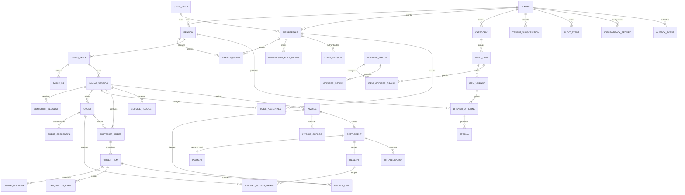

# MenuFlow database design

Status: Phase 0 proposal for approval. Date: 2026-11-06. No database, Prisma schema, migrations, or seed data have been created or executed.

This document defines the intended relational model and transaction boundaries. The [PRD](PRD.md) defines product behavior, [architecture](ARCHITECTURE.md) defines trust boundaries and API ownership, and [decisions](DECISIONS.md) records assumptions that need approval. Entity names are conceptual; exact Prisma mappings and supported database/ORM versions are selected in Phase 1 and implemented incrementally.

## 1. Storage conventions

| Concern | Proposed convention |
| --- | --- |
| Database | One PostgreSQL database with shared tenant tables; each restaurant is one tenant and can own multiple branches. |
| Schema authority | One `prisma/schema.prisma` at the repository root; one migration history under `prisma/migrations`. No app-local copy. |
| IDs | Server-generated opaque UUIDs. IDs are identifiers, never proof of authorization. Human table/order/receipt labels are separate. |
| Tenant ownership | Every restaurant-owned row has a non-null `tenant_id`, including join tables, audit rows, jobs, and financial snapshots. |
| Branch ownership | Branch-scoped rows carry `branch_id`; composite relationships prevent attaching a table, session, or menu price to another branch. |
| Time | Instants use `timestamptz`; branch time zone is an IANA identifier, initially proposed `Africa/Addis_Ababa`. Weekly schedules use local weekday/time plus explicit cross-midnight semantics. |
| Money | PostgreSQL `bigint` integer minor units, initially ETB with exponent 2. Currency and exponent are captured on each session/invoice. API money values are decimal digit strings; TypeScript calculations use `bigint`, never binary floating point. |
| Rates | Integer basis points for percentages. Bounds, maximum quantities, and maximum monetary values are validated before multiplication; calculations fail on overflow. |
| Mutation tracking | Mutable aggregates have `version`, `created_at`, and `updated_at`. Client commands carry expected versions where stale edits can lose work. |
| Locales | BCP 47 language tags, initially `en` and `am`; one row per entity/locale with uniqueness. Unicode text is retained without transliteration. |
| Deletion | Archive menu/staff/table records referenced by history. Restrict cascades across orders, invoices, payments, and receipts. Purge ephemeral credentials under a defined retention policy. |
| JSON | Use versioned JSON for bounded provider metadata, event payloads, and policy snapshots, not as a substitute for relational monetary lines or access-control relationships. |

## 2. Entity relationships

This diagram shows core cardinalities, not every property or supporting table. Composite tenant and branch keys apply even when not drawn.

Some dining sessions can have no guest yet; staff open them first. An admitted guest submits their own orders. A voided or empty session need not have an invoice. A settled invoice has exactly one successful settlement: one full cash payment for a positive balance, or an explicit zero-balance close with no fictional payment.

## 3. Identity, tenancy, and configuration

| Entity | Important data and rules |
| --- | --- |
| `Tenant` | Restaurant identity, public slug, legal/trading names, default locale, branding asset, status (`onboarding`, `active`, `suspended`, `closed`). Tenant status and subscription status remain separate. Suspension does not erase history; operational effects must follow the approved policy. |
| `Branch` | Tenant, name, address, time zone, currency/exponent, business contact, active status. Currency changes are rejected while an active session exists; historical session currencies never change. |
| `OperatingHours` / `OperatingException` | Branch, weekday/local interval or date override, closed flag. Support multiple intervals and overnight opening; service date boundaries are explicit. |
| `BillingPolicyVersion` | Tenant/branch scope, effective time, tax-exclusive policy proposal, tax/service-charge rates and bases, tip eligibility rules, rounding version. Referenced versions are immutable. No statutory tax percentage is assumed in Phase 0. |
| `StaffUser` | Global account identity, normalized unique login email, display name, password hash, verification/disabled status, security version. A user may belong to multiple tenants. Public APIs never expose account existence. |
| `Membership` | Tenant/user unique pair, status, security version. This is the authorization principal for restaurant operations. |
| `MembershipRoleGrant` | Tenant/membership/role unique tuple for owner/manager/waiter/kitchen/cashier, with grant/revoke actor and timestamps. Multiple operational roles require explicit grants; owner/manager status does not implicitly grant kitchen or cashier actions. |
| `BranchGrant` | Tenant/membership/branch unique tuple. Owner may operate across its tenant; other roles require assigned branches. Grant removal takes effect on the next request and revokes relevant socket subscriptions. |
| `PlatformRoleGrant` | Global user/platform role, grant/revoke actor and timestamps. Platform administration does not silently grant access to guest bills or restaurant operational data. |
| `StaffSession` | Hash of opaque session secret, user, active membership, expiry, idle-use timestamp, security version, revocation. The browser holds the secret only in an HTTP-only cookie. Switching tenants revalidates membership and replaces the active context. |
| `StaffInvitation` | Tenant, normalized email, requested role/branches, inviter, token digest, expiry, consumed/revoked timestamps. Single-use acceptance creates or connects a user transactionally. Only authorized owners/managers may grant roles within their delegation scope. |
| `AccountToken` | User, purpose (`verify_email`, `reset_password`), digest, expiry, consumed timestamp. Credential reset invalidates existing sessions; raw tokens and passwords are never stored. |

Global identity and platform tables have no artificial restaurant owner. They live behind dedicated identity/platform repositories with narrower grants. Most application repositories cannot query them directly. Tenant membership must be resolved through this narrow bootstrap path before a tenant-bound transaction can start.

## 4. Catalog, schedules, and media

| Entity | Important data and rules |
| --- | --- |
| `Category` / `CategoryTranslation` | Tenant, sort position, archive status; localized label/description unique per locale. |
| `MenuItem` / `MenuItemTranslation` | Tenant/category, base description, dietary/allergen declarations, image asset, archive status; localized name and description. Allergen content is restaurant-authored and never inferred. |
| `ItemVariant` / `VariantTranslation` | Item, size/variant code and localized label. Every item has at least one default variant so pricing has one model. |
| `BranchOffering` | Branch/variant unique pair, currency, integer unit price, availability (`available`, `sold_out`, `hidden`), version. Phase 0 does not promise stock counts or inventory reservation. |
| `ModifierGroup` / translations | Tenant, localized labels, default selection bounds. No customer tip is modeled as a menu modifier. |
| `ModifierOption` / translations | Group, localized label, price delta, active status. Negative deltas are disallowed for MVP; discounts use auditable adjustment rules. |
| `ItemModifierGroup` | Item/group unique pair with per-item required/min/max selection rules and display position. Option references must belong to a permitted group. |
| `BranchModifierOption` | Branch/option unique pair, availability and branch price delta. Server validates both the item offering and modifier offering at order submission. |
| `MenuSchedule` / `ScheduleEntry` | Branch, breakfast/lunch/dinner label, local weekday/time windows and date bounds; entries reference offerings. Rules for overlapping schedules are deterministic; overnight intervals are normalized and tested. |
| `Special` / translations | Branch offering, localized promotional label, start/end instants, optional promotional price, priority and active status. Reject ambiguous overlapping price promotions for the same offering. A label-only special need not change price. |
| `MediaAsset` | Tenant, opaque object key, MIME type, byte size, dimensions, checksum, upload validation status, owner/use association, deletion timestamp. Only validated assets become publicly readable menu images; object names never grant tenant authority. |

Catalog management retains a stable item identity. Order snapshots make historical bills independent of later changes to names, translations, pricing, modifier rules, or availability. Catalog archive does not delete referenced items. Schedule and promotion eligibility is determined by server time in the branch time zone.

## 5. Tables, admissions, and guest privacy

| Entity | Important data and rules |
| --- | --- |
| `DiningTable` | Tenant/branch, unique active label within branch, capacity, operational state (`available`, `out_of_service`), archive status. Occupancy and checkout state are derived from the active session rather than edited independently. |
| `TableQr` | Table, public random locator lookup digest, encrypted recoverable locator for authorized reprint, encryption key version, QR generation, created/revoked timestamps. At most one active QR generation per table. Digest alone cannot reconstruct a printable QR; staff download decrypts the stored locator through the authorized backend. The public locator exposes menu/table context only. |
| `DiningSession` | Tenant/branch/table, state (`open`, `checkout_requested`, `settled`, `voided`), currency/exponent, policy version, opened/closed actors and timestamps, version. At most one nonterminal session per table. Staff opens it and must explicitly close or void it; timeout alone cannot erase an unpaid visit. Voiding requires no remaining liability. |
| `AdmissionRequest` | Session, pending device credential digest, short displayed challenge, status/expiry, approving staff membership, exchange/consumption timestamps. Staff approval creates an approved admission and guest; the original device proves possession of its pending credential in a single-use exchange that issues its guest credential. Pending requests reveal no guest names, orders, running totals, or session identifier beyond the opaque approval reference needed by that device. |
| `Guest` | Session-bound pseudonymous participant, admission actor/time, revocation status, explicit bill-host capability and capability version. No registered customer account is required. At most one active bill host per session under the proposal. |
| `GuestCredential` | Guest, high-entropy secret digest, expiry, revocation, last use. Session secret remains in an HTTP-only cookie; it never appears in a QR, URL, socket room name, or log. A copied QR cannot recreate this credential. |
| `ReceiptAccessGrant` | Receipt, host-at-settlement recipient, separate high-entropy token digest, expiry and revocation. Grants read-only access to the consolidated receipt after dining capabilities end; proposed lifetime is 24 hours. A narrow terminal exchange proves that host credential and settlement-only expiry/revocation before issuing the secure cookie. Preserve the original digest for that bounded exchange; security revocation denies it. Ordinary guests and superseded hosts cannot obtain the group receipt. |
| `TableAssignment` | Session, assigned waiter membership, start/end times, assigning actor. At most one current primary waiter; reassignment preserves history. Assignment is validated against active branch grants. |

Admission is staff-approved for each device. A second device cannot acquire another guest's credential by scanning the table QR. Guest reads and cancellations are scoped to their own orders. Full consolidated bills require the explicitly designated bill host or an authorized staff reader; guest checkout and tipping require the bill host. Staff may assist the host on the host's authorized device but cannot silently set a tip. Host transfer is a staff-authorized and audited operation. Session settlement revokes dining capabilities and may issue separate scoped receipt access; a future party at the same table starts with fresh records and secrets.

Proposed partial unique indexes enforce the active-session, active-QR, primary-waiter, and active-host rules. PostgreSQL partial unique indexes constrain just the rows matching a predicate; implementation will use version-controlled SQL where the selected Prisma version cannot faithfully express or migrate a constraint. See [PostgreSQL partial index documentation](https://www.postgresql.org/docs/11/indexes-partial.html). No PostgreSQL version is selected by that reference.

## 6. Orders and service requests

| Entity | Important data and rules |
| --- | --- |
| `CustomerOrder` | Session, submitting guest, branch-local display number, submitted timestamp, immutable currency, request correlation ID, version. Header status is a projection of item states, not a separately writable truth. |
| `OrderItem` | Order, source offering/item/variant references, captured localized display names, quantity, unit price, modifiers subtotal, line subtotal, source price version, tax category/policy reference, special instruction, current fulfillment state, version. Entire quantity follows one state in MVP. |
| `OrderModifier` | Order item, source group/option references, name snapshot, quantity and price delta snapshot. Validated server-side before the item is inserted. |
| `ItemStatusEvent` | Item, from/to state, actor, reason, timestamp, command ID. Append-only history, including cancellation approvals. |
| `ServiceRequest` | Session, requester, category (`waiter`, `water`, `cutlery`, `other` initially), bounded note, state (`requested`, `acknowledged`, `completed`, `cancelled`), assigned/acknowledging actor and timestamps, version. Checkout uses its own billing command rather than an unstructured service note. |

The authoritative item state machine is `submitted -> accepted -> preparing -> ready -> served`. Skipping or reversing states is rejected. Guest cancellation can cancel their whole order only while every line is still submitted. Authorized staff may cancel an unserved line; cancelling accepted/preparing work requires owner/manager approval and a reason. Ready-line cancellation must follow the role policy in the PRD. Served items remain in history and require an authorized financial adjustment if disputed. Partial-quantity cancellations are excluded initially.

Order aggregation must be defined once and reused by API, kitchen, waiter, customer, and reports. Proposed rule: ignore cancelled lines; if none remain, the order is cancelled; otherwise show the least advanced remaining line state. This keeps mixed ready/served orders in ready, and mixed accepted/preparing orders in accepted. Item progress is displayed alongside the aggregate so staff can see partially served orders. Bulk actions validate and update each eligible line atomically; they cannot conceal forbidden transitions.

## 7. Invoices, cash settlement, tips, and subscriptions

| Entity | Important data and rules |
| --- | --- |
| `Invoice` | Session, monotonically increasing revision, currency/exponent, source session version, policy/rounding version snapshot, state (`issued`, `superseded`, `settled`, `void`), bill host consent version, item subtotal, discount, tax, service charge, tip, total, timestamps. Unique session/revision; only one issued invoice per session. Monetary content is immutable once issued; changes create a new revision. |
| `InvoiceLine` | Invoice, source order item, quantity/name/variant/modifier snapshots, gross subtotal, allocated discount, eligible tax base, tax amount, net restaurant charge. Reconciliation references are retained even if source catalog entries are archived. |
| `InvoiceCharge` | Invoice, type (`tax`, `service_charge`, `discount`, `tip`), description, base, rate or fixed amount, amount, authorizer/reason where applicable. Separate tip charge is never merged into sales. |
| `BillAdjustment` | Session/invoice source, authorized actor, affected order item if applicable, fixed/percentage adjustment, reason, created timestamp. Cannot make a line or bill negative or silently remove a served item. Post-settlement refund/credit behavior is an open decision and is not implemented by overwriting paid invoices. |
| `TipChoice` | Session, explicit actor and chosen mode (`none`, `percent`, `custom`), selected basis points or amount, eligible subtotal/version, consent timestamp. No selection means zero. Presets are 5%, 10%, 15%; custom values have configured bounds. |
| `Settlement` | Invoice and session, unique successful close, kind (`cash`, `zero_balance`), amount/currency, host-at-settlement guest snapshot, authorized cashier, idempotency command and timestamp. Zero-balance close requires an exact zero payable, audit and receipt; it has no payment row. |
| `Payment` | Settlement/invoice, provider kind (`cash` initially), status, expected/applied amount, currency, recording cashier, idempotency command, external reference if later used, timestamps. Cash tender/change are recorded separately; applied amount equals the positive invoice total. |
| `PaymentEvent` | Payment, append-only state/verification history, actor, provider event identifier and sanitized metadata. Digital verification fields are reserved for a future approved provider integration. |
| `Receipt` | One immutable record per successful settlement, tenant/branch receipt sequence, issued timestamp, immutable receipt snapshot, content hash, optional generated artifact reference and rendering version. Printable data remains available if asynchronous PDF generation fails. |
| `TipAllocation` | Successful settlement, amount, allocation policy snapshot, assigned waiter membership or explicit unallocated bucket. Allocation amounts sum exactly to collected tip. Historical membership remains referenced after staff departure. |
| `TenantSubscription` | Tenant, plan code, manual lifecycle state, trial/period dates, entitlement snapshot, optional provider reference reserved for the future. No live recurring charging or fabricated paid subscription state. |

One consolidated bill and one full cash payment per positive-balance session are proposed for MVP. Split bills, partial settlement, transfers/merges of occupied tables, refunds after payment, provider payments, and automatic subscription charging require separate approved scope and invariants. A zero-total bill uses the separate authorized zero-balance-close operation and settlement kind, with audit and receipt but no payment or cash tender. An empty or fully cancelled no-liability session may instead be explicitly voided.

### Calculation proposal

Tax and receipt legality must be confirmed for the target operating model before Phase 6. The following is an engineering policy proposal, not a declaration of Ethiopian tax rules:

1. Calculate item subtotal from captured integer unit and modifier prices multiplied by quantities. Exclude only cancelled lines; retain served items and separately approved adjustments.
2. Apply authorized item discounts, then allocate any bill-wide discount proportionally using integer division and deterministic largest-remainder distribution. Tie-break by stable line ID. Allocation must sum exactly to the approved discount.
3. Calculate tax per line on the eligible post-discount base with nonnegative half-up rounding: divide `base_minor * basis_points` by `10000`, rounding an exact half upward. Store each base/rate/result. Do not combine independently rounded line taxes with a conflicting invoice-level recomputation.
4. Calculate optional service charge from its explicitly configured eligible base. Its taxable status is an unresolved business setting; no assumed treatment is encoded into seed data.
5. Calculate voluntary percentage tips from the eligible discounted pre-tax item subtotal, excluding tax/service charge by default. Store custom tips as validated minor-unit amounts. A changed subtotal invalidates prior tip consent.
6. Sum discounted item amounts, taxes, service charge and voluntary tip to obtain total due. Store each component and reconcile using integer arithmetic. Tips are liabilities/payable allocations, separate from restaurant sales.

An engineering fixture such as a 10,001-minor-unit eligible base at 500 basis points yields a 500-minor-unit tip under half-up rounding. Tax examples and fixtures must be labelled synthetic, never used as an assumed statutory configuration.

Checkout is allowed only after every noncancelled item is served. Under the session lock, the server freezes further orders and admissions, computes and issues the invoice, and records its source version. Explicit tip changes before payment produce a superseding invoice revision. Authorized reopening invalidates the old invoice and tip consent, then returns the session to open. Settlement accepts only the current invoice/version, rechecks all eligibility, and atomically records settlement, the cash payment when applicable, receipt, tip allocation, session closure, audit, and outbox events.

## 8. Reliability and audit records

| Entity | Important data and rules |
| --- | --- |
| `IdempotencyRecord` | Tenant, stable actor scope, operation kind, key digest, canonical payload hash, status, resulting resource ID, response status/body or reconstruction reference, created/expiry timestamps. A unique constraint covers the complete scope. Same key/different payload is a conflict. Reauthentication and current resource authorization still precede any replay. |
| `AuditEvent` | Tenant/branch where applicable, actor type/ID, action, target type/ID, reason, timestamp, correlation ID, bounded redacted before/after facts. Application role may insert but not update/delete audit history. Platform audits use a separate explicitly global stream. |
| `OutboxEvent` | Tenant, event UUID/type/schema version, aggregate ID/version, bounded payload, created/available timestamp, attempt count, delivered timestamp. Inserted in the same transaction as the domain change. Worker delivery is at least once; event IDs deduplicate consumers. |
| `JobExecution` | Tenant, job purpose, stable deduplication key, attempts/status, result reference, sanitized last error. Durable business truth stays in PostgreSQL; Redis/BullMQ is transport/scheduling infrastructure, not the payment ledger. |
| `ReceiptSequence` | Tenant/branch/approved numbering period, next counter. Updated under a lock in settlement, independently of nonfinancial order display numbering. Voided numbers are retained if required by the approved receipt policy. |

Do not store raw passwords, QR admission secrets, session secrets, reset/invitation tokens, raw card data, access tokens, or unredacted provider bodies in audit/outbox rows. Security logs may use hashed or short-lived IP metadata only under an approved retention policy.

## 9. Tenant enforcement and database roles

Every tenant parent exposes a unique `(tenant_id, id)` pair. Child foreign keys include `tenant_id`; branch descendants use `(tenant_id, branch_id, id)` when needed to enforce matching branch. Tenant ownership cannot be updated after creation. Natural uniqueness is scoped: table labels per branch, menu codes per tenant, and order/receipt numbers per branch and approved numbering period.

Application policy checks derive tenant, branch, membership, guest and capabilities from the authenticated server session. A request field or URL selects a resource; it cannot establish authority. Staff repositories require explicit validated tenant/branch context. Guest repositories additionally constrain session, guest ownership and bill-host capability. Background jobs revalidate their tenant and resource state rather than trusting arbitrary queue payloads.

Proposed PostgreSQL row-level security adds a tenant boundary underneath those checks. Use separate migration-owner, application-runtime, narrowly scoped identity/public-resolution, and backup roles. The application role must be neither owner, superuser, nor `BYPASSRLS`; consider `FORCE ROW LEVEL SECURITY` for protected tables. Policies must cover reads and write checks, including inserts and updates. PostgreSQL owners normally bypass RLS and superusers/`BYPASSRLS` roles bypass it; tests must use the actual runtime role. See [PostgreSQL row security policies](https://www.postgresql.org/docs/17/ddl-rowsecurity.html).

Set validated tenant context transaction-locally before any tenant query and use the same database connection/transaction for all dependent reads and writes. Missing context fails closed. Do not rely on connection-wide context surviving connection pooling. RLS expresses the tenant boundary; it does not replace role authorization, field filtering, guest privacy, or branch checks. Since a compromised application can set its own context, this is protection against missing query scope, not a claim of isolation from complete application compromise.

Public QR/slug resolution needs an intentionally narrow route: resolve only published restaurant/branch/table pointers through an allowlisted lookup or public projection; then query only published menu fields under the resolved tenant. It must never expose session, order, staff, or bill rows. Global identity bootstrap and platform administration similarly have explicit least-privilege paths; neither gives the ordinary runtime a universal tenant bypass.

Phase 1/2 must prove the selected Prisma version/driver, PostgreSQL version, transaction connection semantics, pooling mode, transaction-local settings, and custom SQL migrations work together. No ORM API method or version is assumed here. If the compatibility experiment fails, revise the decision before shipping tenant data; do not silently remove isolation controls.

## 10. Constraints, indexes, and transactions

### Constraints required in migrations

- Composite tenant/branch foreign keys across all owned relations; non-null tenant IDs and currency on financial records.
- Positive quantities; nonnegative bounded price/charge fields; supported currency exponent; valid time intervals; valid modifier selection bounds.
- Unique normalized account email, tenant slug, tenant/user membership, branch/variant offering, localized entity/locale, and scoped business labels.
- Partial unique indexes for one nonterminal session per table, active QR per table, active primary waiter, active bill host, and current issued invoice. Unique settlement constraints cover both invoice and session; payment and receipt references are unique per settlement. Expiry alone must not be used as a time-dependent index predicate: update status explicitly.
- Unique session/invoice revision, receipt/payment reference, provider/event reference when enabled, idempotency scope/key, and outbox event ID.
- Restrict deletion of financial/order history; prohibit mutation of immutable snapshots except defined lifecycle metadata. Privileges, service ownership, and targeted database triggers should protect this boundary where ordinary check constraints cannot.
- Payment amount/currency must match current invoice under the settlement transaction. Aggregate invariants such as sum of allocations, line totals, all served, and same-session references require transactional checks or carefully scoped constraints/triggers; do not claim a row-level check can validate arbitrary child rows.

### Index plan

Start with foreign-key indexes plus indexes serving actual access patterns: `(tenant_id, branch_id, created_at, id)` for order pagination; `(tenant_id, branch_id, current_state, submitted_at)` for active kitchen items; `(tenant_id, session_id, created_at)` for session orders/requests; `(tenant_id, branch_id, paid_at)` for financial reporting; token digest indexes for credential lookup; pending outbox status/available time; expiry indexes for cleanup. Kitchen projections may carry branch/order submission keys with constraints to avoid repeated large joins. Review query plans against representative fixtures before adding speculative indexes.

### Critical transaction boundaries

| Operation | Serialization and atomic work |
| --- | --- |
| Open table session | Lock table, check availability and no live session, create session/assignment/audit; partial unique index is the final race guard. |
| Approve guest | Lock session, check open and authorized staff/branch, mark unexpired admission request approved, create guest, optionally set host, append audit. Approval does not reveal a credential to staff. |
| Exchange admission | Lock session/admission; prove original device credential, require approved/unexpired/unconsumed admission and open session; consume admission and issue guest credential to that device in a secure cookie, append audit. |
| Submit order | Authenticate and reserve/check idempotency scope, lock dining session, require open, validate current offerings/modifiers/schedule and expected prices, create snapshots/items/events/outbox, complete idempotency record atomically. Changed prices require explicit customer acceptance, never silent increase. |
| Update item state | Lock session then affected orders/items in a consistent ID order; verify expected version and role/assignment, transition valid lines, increment session version, append state history/audit/outbox. |
| Cancel order/line | Same locks; recheck all cancellation predicates after locking, capture authorizer/reason, preserve cancelled snapshots, invalidate affected financial quote if any. |
| Request checkout / tip revision | Lock session and current invoice, require all remaining items served; freeze orders, calculate snapshot, supersede previous quote if relevant, issue new revision and record explicit consent. |
| Record cash payment | Resolve idempotency then lock session/current invoice; validate state, version, item readiness, currency/amount and cashier authority; record settlement/payment/receipt/allocations, mark invoice/session settled, revoke dining credentials and issue permitted receipt access grants, append audit/outbox in one commit. |
| Close zero-balance invoice | Same serialization and authorization as cash settlement; require exact zero due, record zero-balance settlement/receipt/audit/outbox with no payment row or fictional tender, then close session and issue scoped receipt access. |
| Reopen checkout | Lock session/invoice; require no successful settlement of any kind, staff authorization and reason; supersede invoice, invalidate tip consent and increment version before opening ordering. |

All writers affecting a session's bill must take the same session lock first; a lock only in checkout cannot stop an order writer that ignores it. Menu updates use versioned offering/policy validation with a defined lock order so order acceptance sees a consistent price/availability decision. Keep locks short and exclude network, object-storage, email, and PDF calls from transactions. API success follows commit; sockets and jobs deliver only committed outbox events.

Use bounded jittered retries for database serialization/deadlock failures (PostgreSQL SQLSTATE `40001`/`40P01`), mapped through the pinned Prisma/driver version. A retry reruns the entire transaction, keeps the same idempotency key, and has a strict attempt/time cap. Exhaustion returns a retryable error without asserting success. Idempotency retention must exceed the supported offline retry window; settled resource uniqueness prevents an old key from creating a second settlement even after deduplication cleanup. No offline order is shown as accepted until the server confirms commit.

## 11. Reporting, retention, and migration delivery

Analytics initially query settled immutable financial snapshots with tenant/branch authorization and bounded date ranges. Business-day windows derive from branch time zone. Define restaurant revenue as item charges after discounts plus approved service charges, excluding tax and tips; show collected tax/tips separately. Order count includes the explicitly selected fulfillment/payment status, and average order value uses the same numerator/denominator definition. Do not mix unsettled kitchen totals with cash collected. Add materialized summaries only after measured need and reconciliation tests.

Retention durations for receipts, accounting records, audit events, guest identifiers, admissions, IP metadata and backups are open decisions requiring business/legal validation. Minimize guest PII now so receipt history can remain without retaining device credentials. Financial records are not removed by tenant deletion jobs; offboarding follows an approved retention/export process. Archive and backup access are separately controlled. Production backup policy must include encryption, restore drills, RPO/RTO targets, and recovery of database plus referenced object storage.

| Phase | Database deliverable |
| --- | --- |
| 1 | Local PostgreSQL and migration tooling; runtime/migration role and connection compatibility experiment; no claim of domain workflow completion. |
| 2 | Tenant, identity, membership/branch permissions, security credentials, audit foundations, isolation policies and adversarial fixtures. |
| 3 | Branch settings, catalog/translations, prices/modifiers, schedules, media metadata, table records and immutable policy versions. |
| 4 | QR generations, staff-opened dining sessions, admission and guest capabilities. |
| 5 | Orders and snapshots, transitions, assignments/service requests, idempotency and transactional outbox. |
| 6 | Invoice revisions, adjustment/tip consent, payments/receipts/allocations and settlement constraints. |
| 7 | Subscription metadata and verified reporting indexes/projections. |
| 8 | Upgrade/restore rehearsal, runtime-role isolation audit, retention jobs and production backup verification. |

Migrations are committed and reviewed; deployed migrations are not edited. Use expand/backfill/contract changes when data compatibility matters. Custom SQL constraints/RLS/indexes remain in the same migration history, with drift checks that verify them. Test migrations from an empty database and a representative previous schema snapshot. Development/test fixtures use synthetic restaurants and separate credentials and cannot run against production implicitly. Production migration execution and infrastructure changes remain subject to explicit approval.

## 12. Verification required before these designs are complete

- Attempt cross-tenant reads, inserts, updates, deletes, join traversal, nested writes, raw queries and socket subscriptions under the nonowner runtime role, including a user belonging to two tenants and absent/stale tenant context.
- Run concurrent open-session, order, cancellation, checkout, tip revision and cash settlement requests; assert one valid outcome and no lost orders, orphaned receipts, duplicated tips, or unpaid closed sessions.
- Prove rotated QR codes cannot admit new guests, reused tables do not expose previous visits, pending devices cannot read bills, guests cannot read each other's orders, and bill-host transfer/revocation takes effect immediately.
- Exercise the complete modifier/schedule/price validation matrix, catalog mutation during submission, branch mismatch, archived references, exact price-change response, and replay with changed payload.
- Check integer arithmetic boundaries, deterministic discount remainders, half-up rounding, cancelled/served adjustments, voluntary zero tips, custom-tip limits, invoice supersession, and sum of tip allocations.
- Kill a process around commit/outbox delivery/receipt rendering; replay safely without simulating payment success. Restore a representative backup and reconcile payment, receipt and outbox counts.

These are planned acceptance tests. None has run in Phase 0 because application and database code do not yet exist.
